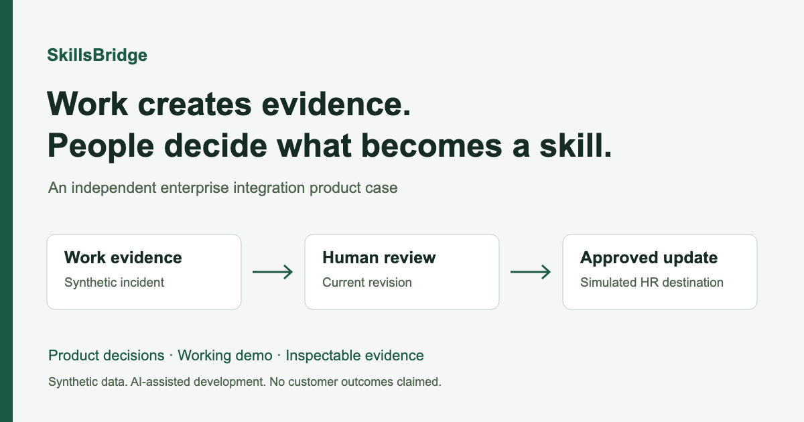
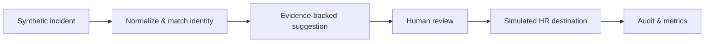

# SkillsBridge
### Enterprise skills integration — evidence before expertise.

**[Open the interactive demo](https://phlppgdfry.github.io/skillsbridge-showcase/)** · **[Executive case study (PDF)](https://phlppgdfry.github.io/skillsbridge-showcase/showcase/case-study.pdf)** · **[Evidence & limitations](https://phlppgdfry.github.io/skillsbridge-showcase/?view=library&doc=showcase%2Fgithub-pages-demo.md)**

Useful work evidence can remain invisible in HR profiles. Automatically turning a resolved incident into a skill would introduce an attribution risk. SkillsBridge explores a focused alternative: **preserve evidence, require human review and deliver only the approved revision**.

## Explore in three minutes
1. Start the guided tour; inspect why human validation and reliable delivery were prioritized.
2. Import a fictional incident, inspect the suggestion, approve it and synchronize.
3. Trigger a destination outage, restore it and advance the retry clock. Inspect recovery and the audit trail.
4. Open the evidence library and Launch readiness to distinguish tested behavior from pilot prerequisites.

## What actually runs
Six screens include a Product Decision Lab, guided tour, integration simulator, governance queue, roadmap and launch-readiness review. The public site reuses the server prototype's deterministic engine through a browser-only transport. Approval, rejection, duplicate suppression, missing identity, stale evidence, rate limits and outage recovery are simulation rules, not real enterprise integrations.

**No signup, credentials or paid API is required.** All data is synthetic and stays in this tab's temporary memory. Reload resets the demo. Demo roles illustrate permissions; they are not authentication. Live ESCO requests are disabled and explicitly fall back to a recorded taxonomy reference. The server prototype's API/contract and external-reference receipts describe their stated environments, not a backend running on GitHub Pages.

## Inspect the product reasoning
- [MVP and requirements](https://phlppgdfry.github.io/skillsbridge-showcase/?view=library&doc=product%2Fproduct-requirements.md)
- [Decisions and alternatives](https://phlppgdfry.github.io/skillsbridge-showcase/?view=library&doc=product%2Fdecision-log.md)
- [Architecture](https://phlppgdfry.github.io/skillsbridge-showcase/?view=library&doc=architecture%2Fsystem-overview.md)
- [Executed automated test receipt](https://phlppgdfry.github.io/skillsbridge-showcase/?view=library&doc=validation%2Fpublic-test-evidence.json)
- [One-page director brief](https://phlppgdfry.github.io/skillsbridge-showcase/showcase/director-brief.pdf)

The overview also offers an existing three-minute recording, timed English descriptions and a text alternative. Its interface predates the current presentation; the runnable demo is the current experience.

## Contribution and honesty
Created as an independent product case by Philippe Godfroy, using AI-assisted analysis, writing, design, implementation and testing. The artifacts demonstrate inspectable project work; they do not establish professional employment experience or independent interview mastery.

**SkillsBridge is an independent enterprise product management and integration case study built using synthetic data and simulated enterprise integrations.** No TechWolf affiliation, customer validation, real employee data, vendor certification, measured business outcome or production deployment is claimed. Product priority inputs and business benefits remain hypotheses. The next meaningful evidence is professional feedback and a narrowly scoped authorized pilot.

## Distribution boundary
This fresh-history repository contains only reviewed compiled website assets, selected public evidence and the Pages deployment workflow. The development repository and its history remain private. Career files, outreach drafts, interview notes, personal feedback, credentials and source maps are excluded. No source-code license has been assigned automatically.

GitHub Pages serves static files; there is no Worker, durable database, enterprise SSO, scheduler or real HR write. This is a portfolio demonstration, not an enterprise production service.
