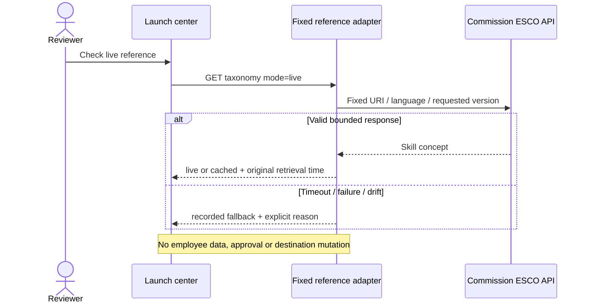

# Genuine ESCO reference adapter

## Purpose and boundary
Inspect one official vocabulary reference during integration design. A genuine external API call demonstrates contract handling without requiring enterprise credentials. This is not a ServiceNow/Workday connector and does not validate the business proposition.

GET /api/taxonomy?mode=fixture (default) returns a recorded provider observation without network access. mode=live performs a bounded server-side request to one hard-coded Commission endpoint. No arbitrary URL, search term, event, employee ID, evidence text or credential is accepted. Unknown/duplicate query parameters return a consistent 400 error.

Provider URI: http://data.europa.eu/esco/skill/744442ac-c157-4350-8be0-ce454df4f5c5. English preferred label: “perform ICT troubleshooting”. Request selectedVersion=v1.2.0 explicitly. Because the response does not confirm the effective version, expose that uncertainty. The public overview's listed available versions and footer are not fully aligned.

## Validation and failure policy
Validate URI, className=Skill and nonempty bounded English label. Reject redirects, unexpected content types, invalid JSON, mismatched concepts and bodies exceeding 64KB. Abort the fetch after five seconds. Cache a successful response and coalesce concurrent requests. Apply a 60-second process-local cooldown after success/failure; no background retries. Hosted distributed quotas are not guaranteed by this local mechanism.

| Mode | Meaning |
|---|---|
| fixture | Recorded official reference, no live request, original retrieval timestamp |
| live | Validated provider response retrieved on this request |
| cached | Prior successful response reused; original retrieval time retained |
| fallback | Attempt failed or cooldown active; recorded reference retained with a visible reason |

Fallback must never appear as live. Endpoint errors do not mutate review or sync state. Tests use injected responses and fake time; CI makes no live ESCO calls. A separate local observation records a genuine external request.

## Mapping governance
This concept is broader than Northstar's network-specific label. Semantic equivalence, taxonomy coverage and destination crosswalk are unvalidated. Reference mode cannot approve a suggestion, resolve an unsupported destination skill or bypass human review. Destination HR-NET-01 remains fictional.

## Provenance and reuse
lib/adapters/esco-reference.json and research/esco-observation.json contain the minimal label/URI metadata, request URL, retrieval timestamp and response SHA-256. No full bulk taxonomy is redistributed. Official ESCO legal/reuse terms apply; no certification or endorsement is implied.

