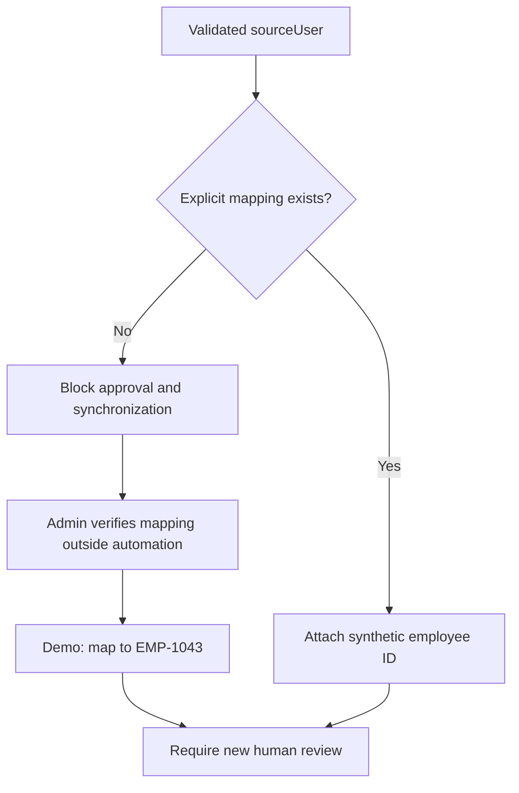

# Employee identity mapping

Names and email similarity are not used. Missing mapping is an exception, not an invitation to guess. The demo resolution is a deliberately named synthetic action; it does not implement an enterprise identity registry. In production, the architect must validate tenant scoping, leavers, contractors, rehires, merge behavior and changes in source identities. HR owns authoritative identity; product defines the safe exception outcome; engineering selects implementation with the architect.
