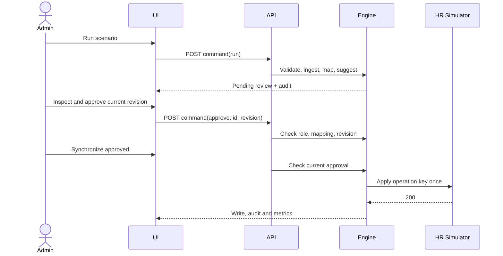
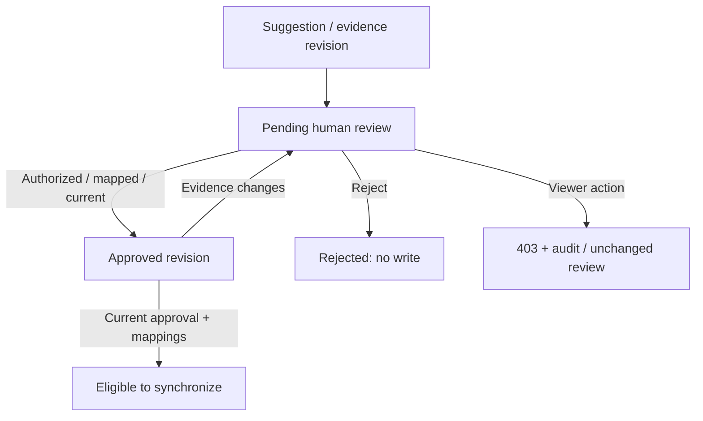
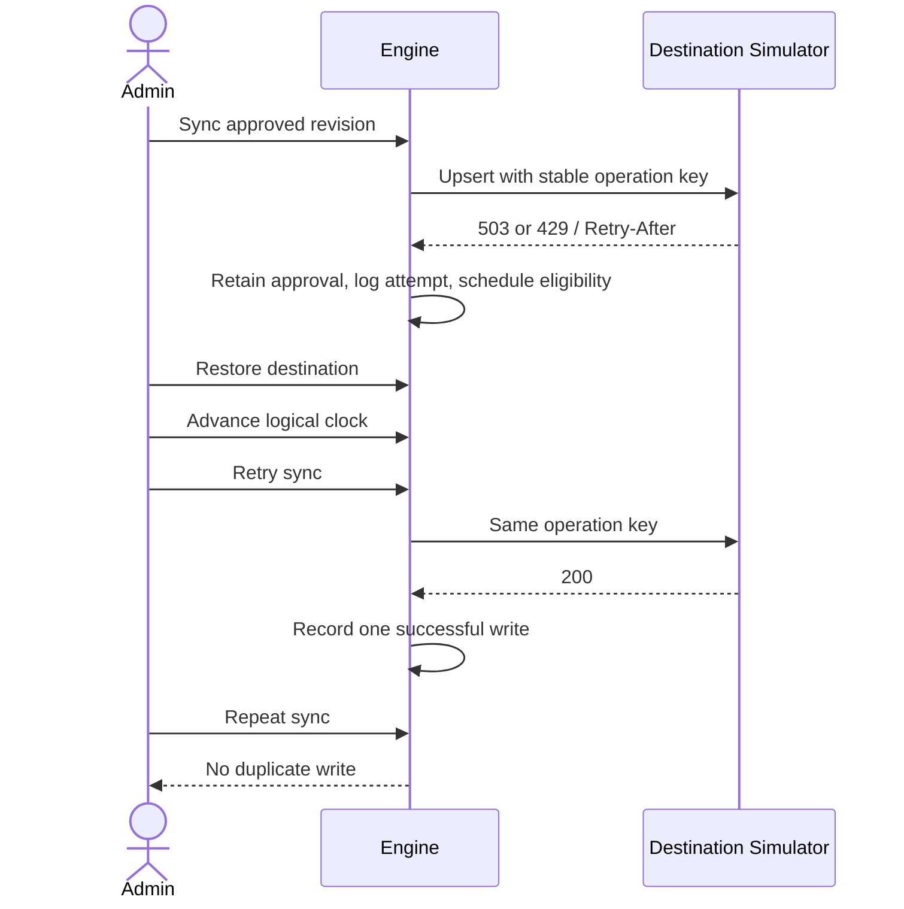
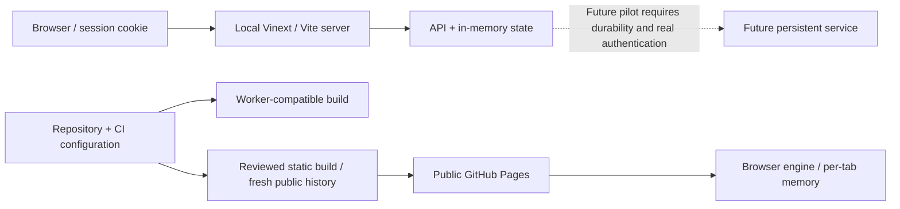

# Interaction sequences
## Approved update

## Review lifecycle

## Failure and recovery

Lost acknowledgement after a real remote commit is not modeled. The real adapter would need remote idempotency or reconciliation before retries could make the same guarantee.

## Deployment boundary

The [public GitHub Pages demo](https://phlppgdfry.github.io/skillsbridge-showcase/) is deployed and anonymously verified as a browser-only simulation. It does not execute the Worker/API or use server cookies. The separately tested Worker build remains a local packaging artifact, not evidence of a hosted backend or production service reliability. [Public runtime scope](../showcase/github-pages-demo.md).
