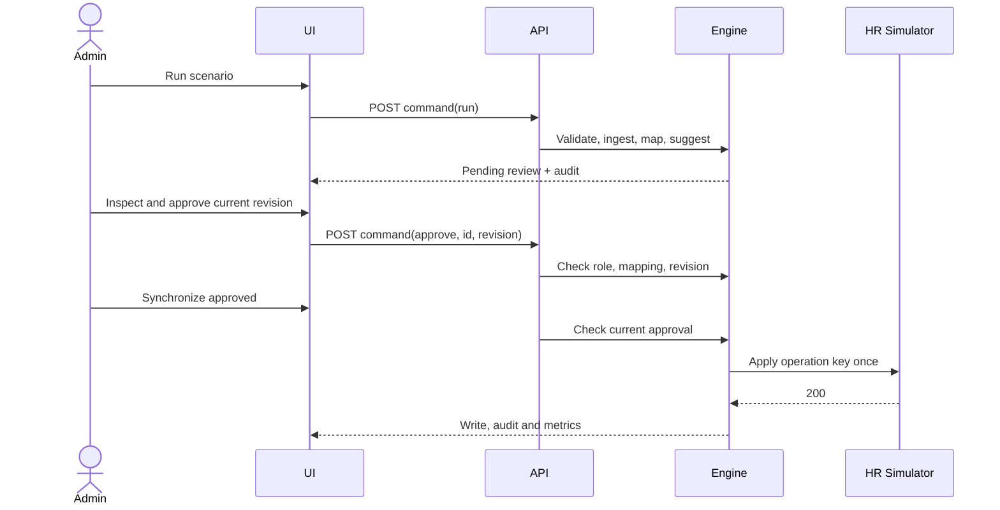
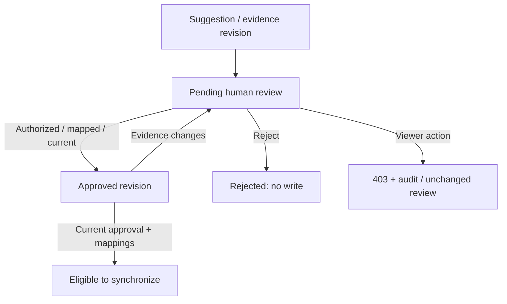
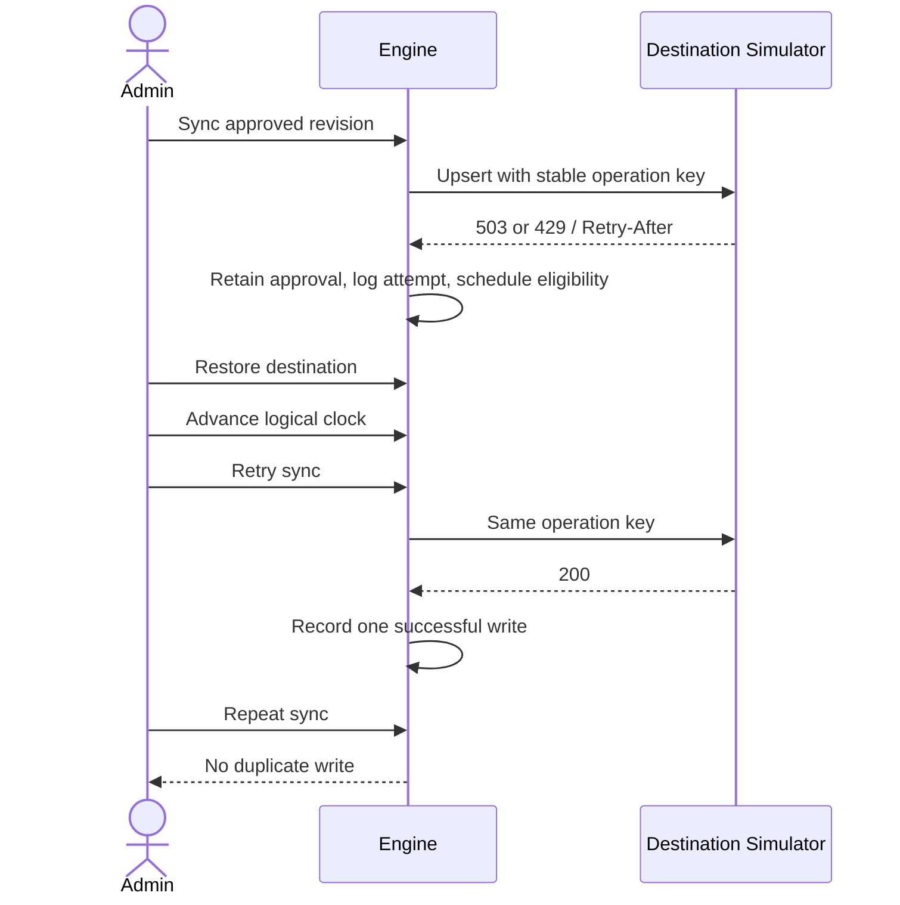
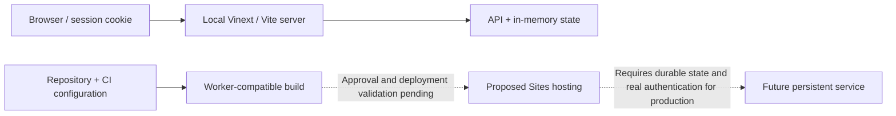

# Interaction sequences
## Approved update

## Review lifecycle

## Failure and recovery

Lost acknowledgement after a real remote commit is not modeled. The real adapter would need remote idempotency or reconciliation before retries could make the same guarantee.

## Deployment boundary

No public deployment is claimed. Generated Worker build is a packaging artifact, not evidence of production service reliability.
