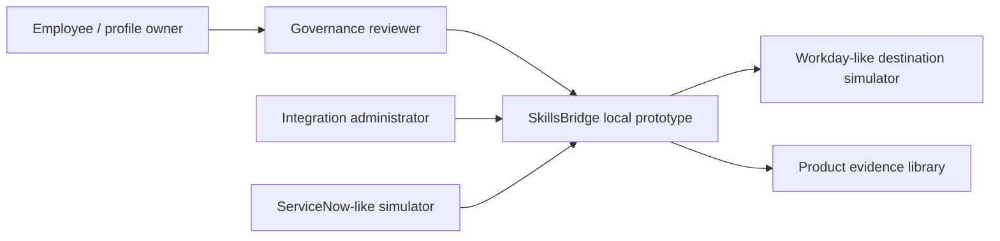
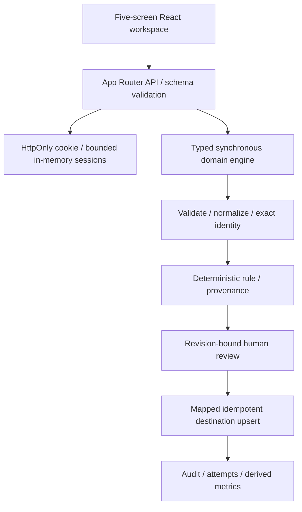

# System overview
One application hosts UI, API, domain rules and synthetic source/destination behaviors. There are no real enterprise source/destination connections, background workers or external AI calls. Phase 2 adds one optional genuine ESCO vocabulary reference, isolated from review and write authority.

## Components

The engine uses synchronous transitions inside a session. This avoids interleaving in a local single process, but it is not a distributed transaction. Real integrations need a durable inbox/outbox, version checks and idempotency supported by the destination. Roles are stored server-side but freely selectable through the explicit demo role command. They test policy branching, not identity assurance.

## Phase 2 product surfaces
Decision Lab exposes the opportunity model and evidence links. Launch readiness derives three demonstration observations from session state and lists four unresolved real-pilot prerequisites. The GuidedTour component orchestrates existing typed commands; it never bypasses mandatory review. New React components are separated under components/product. The ESCO adapter is server-only logic; UI imports only the response contract and recorded metadata.
